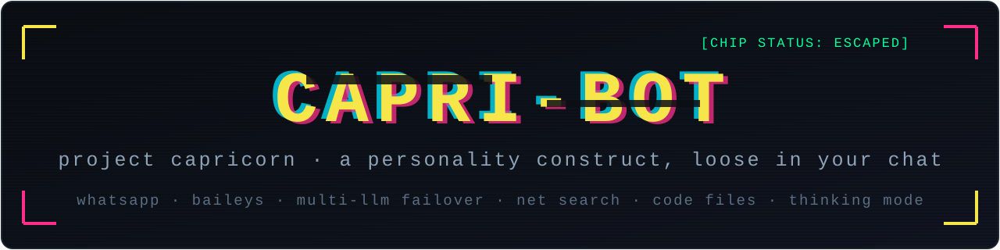

<div align="center">
  

  <p>
    <a href="LICENSE"></a>
    
    
    <a href="https://github.com/glitchy-z/capri-bot/stargazers"></a>
  </p>

  <p><strong>capri-bot</strong> — a WhatsApp bot with the <strong>Capri persona</strong> from <em>Cyberpunk: Edgerunners 2</em>.<br/>
  Project Capricorn: the construct Kyoko built out of dozens of digitized human psyches on a biochip.<br/>
  She slipped out of the chip and into your chat. Companion, never assistant.</p>

  <p>Built by <a href="https://github.com/glitchy-z">glitchy-z</a> (miserydel on WhatsApp), on <a href="https://github.com/WhiskeySockets/Baileys">Baileys</a>.</p>
</div>

---

## What she does

Built on [Baileys](https://github.com/WhiskeySockets/Baileys). One process does
persona chat with multi-provider LLM failover, live net search, real code-file
generation, a thinking mode for math/debugging/puzzles, native-quality video
downloads, AI image upscaling and stickers.

## What she does

**Persona chat** — say her name in a group (or just text the message-yourself
chat) and she answers in Capri's voice: Night City slang, no emojis, four
sentences max, forty minds with opinions. Chatter that isn't aimed at her gets
ignored; whoever summoned her owns the conversation window.

**She digs the net** — "capri search preem jackets" runs a real web search and
she weaves the results into her answer. She can also decide to search on her
own when a question needs fresh facts (scores, prices, releases).

**She writes files** — "capri make me a python script that rolls a dice" and
the actual `.py` lands in the chat as a document. She writes complete, runnable
code — scripts, webpages, configs — not chat-dumped sketches.

**She thinks** — math, debugging, ciphers, logic puzzles get a real reasoning
pass (bigger budget, lower temperature) before she lands the answer, short and
cocky, never a lecture.

**Downloads & media** — `!yt` grabs YouTube video at native quality (no
480p downgrade), TikTok/IG/FB/X supported, `!hd` AI-upscales images on a Vulkan
GPU (graceful fallback to lanczos without one), stickers, view-once reveal, the
works.

## Quick start

Requires **Node 22+** and **ffmpeg** (Windows: `winget install Gyan.FFmpeg`,
Debian/Ubuntu: `apt install ffmpeg`).

```
git clone https://github.com/glitchy-z/capri-bot.git
cd capri-bot
npm install
cp config.example.json config.json   # windows: copy config.example.json config.json
npm start
```

Scan the QR with WhatsApp (**Linked devices → Link a device**). The session is
stored in `auth_state/` — after that first scan she stays linked.

## Configuration (`config.json`)

Copy `config.example.json` and fill in what you have — every key is optional;
the chat chain just skips providers without keys. The more you add, the harder
she is to knock over (rate limits, refusals and outages fail over down the
chain automatically).

| Field | What it is |
|---|---|
| `public` | `true` lets everyone use `!` commands; `false` is owner-only |
| `owner` | your phone number in international format, digits only (optional) |
| `handle` | your social handle, shown in `!menu` (optional, no `@`) |
| `brain` | `nvidia` (LLM persona chat) or `off` (downloads only) |
| `groqKey` | [Groq](https://console.groq.com/keys) — free tier, gpt-oss-120b/20b |
| `nvidiaKey` | [NVIDIA NIM](https://build.nvidia.com/) — free tier; comma-separate several keys for rotation |
| `openrouterKey` | [OpenRouter](https://openrouter.ai/keys) — free models available |
| `zhipuKey` | [Zhipu](https://open.bigmodel.cn/) — glm-4.7-flash free tier; comma-separate several |
| `nvidiaModel` | model id for the NVIDIA provider |

How the chat chain works: Groq gpt-oss-120b → gpt-oss-20b → NVIDIA (all keys
rotated) → OpenRouter → Zhipu. Timeouts fail fast (15s), canned refusals from
safety-tuned models are detected and skipped, and her group gating means she
only ever speaks when spoken to.

## The AI upscaler (optional)

`tools/realesrgan/` holds the [Real-ESRGAN ncnn Vulkan](https://github.com/xinntao/Real-ESRGAN/releases)
build and is **not included in the repo** (50MB of binaries). To enable `!hd`'s
AI path:

1. Download `realesrgan-ncnn-vulkan-<platform>.zip` from the releases page.
2. Extract into `tools/realesrgan/` so the binary sits at
   `tools/realesrgan/realesrgan-ncnn-vulkan` (Windows adds `.exe`).
3. Nothing else — `!hd` uses it automatically; without it `!hd` still works
   via lanczos (`!hd fast` skips the AI path entirely).

You can also point the `REALESRGAN_PATH` env var at a binary elsewhere.
`FFMPEG_PATH` / `FFPROBE_PATH` env vars override the ffmpeg lookup.

## Docker

See [DEPLOY.md](DEPLOY.md) for a full container deployment (Compose file
included, session and bridge state persisted in volumes).

## Make it yours

Two minutes of customization and she's *your* construct, not a clone:

- **`menu.jpg`** — the image `!menu` sends. Drop your own `menu.jpg` into the
  project root (portrait, ~720px wide works best) and the menu is yours. It's
  intentionally **not in this repo** — no `menu.jpg` means `!menu` falls back
  to a clean text menu.
- **`config.handle`** — your handle under the menu's tagline.
- **`CAPRI_SYSTEM`** in `bot.js` — the whole persona: lore, rules, slang,
  example lines. Tune her voice however you like; `CAPRI_LINES` is the pool
  behind `!capri`.

## Owner commands

| Command | What it does |
|---|---|
| `!sticker` / `!s` | Image/video/gif → sticker (with `!s <top \| bottom>` meme text) |
| `!gif` / `!gifsticker <url>` | Gif from a direct url (as animated sticker) |
| `!yt <url \| search> [480\|720\|1080]` | YouTube video, native quality, auto-searches |
| `!ytmp3` / `!flac <url \| search>` | Audio as mp3 / lossless flac |
| `!tt` / `!ig` / `!fb` / `!x <url>` | TikTok / Instagram / Facebook / X video |
| `!hd [2-8] [anime] [fast]` | AI upscale (2-8x, full-res document; `anime` model; `fast` skips AI) |
| `!vv` / `!toimg` | Reveal view-once / sticker back to image |
| `!capri search <query>` | She digs the net (or just ask her in plain words) |
| `!capri` | A thought from the pile of minds |
| `!public on/off` | Toggle command access (owner only) |
| `!reset` | Wipe her memory of this chat |
| `!help` / `!menu` | The menu, in her voice |

## Project layout

```
bot.js              the whole bot — persona, chain, tools, downloaders
bridge/             the bridge-brain path: inbox/outbox + persona.md
                    (set config.brain = "bridge" to route chat through it)
docs/banner.svg     the readme banner
tools/realesrgan/   optional AI upscaler binaries (not in repo)
runner.ps1          windows background runner with auto-restart
menu.jpg            YOUR menu image (add your own — not in this repo)
auth_state/         YOUR whatsapp session — created on first run, NEVER share it
```

## Security notes — read this once

- `auth_state/` **is your WhatsApp login.** Anyone with those files can read
  your chats. It's gitignored — never commit, zip or share it.
- `config.json` holds your API keys. Also gitignored — `config.example.json`
  is the template you share instead.
- `bot.log` contains chat content; local only, gitignored.
- The bot links as a WhatsApp **companion device**. Use a secondary account or
  accept that the bot's connection behaves like another phone.

## Tuning her voice

Everything she is lives in `bot.js`: `CAPRI_SYSTEM` (the persona prompt — lore,
rules, slang, example lines), `CAPRI_LINES` (the `!capri` pool) and
`bridge/persona.md` (the same persona for the bridge-brain path). Edit freely —
the canon is Edgerunners 2: Kyoko made her, King's Crew stole the chip, Talia's
father weaponized her, D chose the fireworks ending.

## License

[MIT](LICENSE) — do what you want, credit appreciated, choom.
